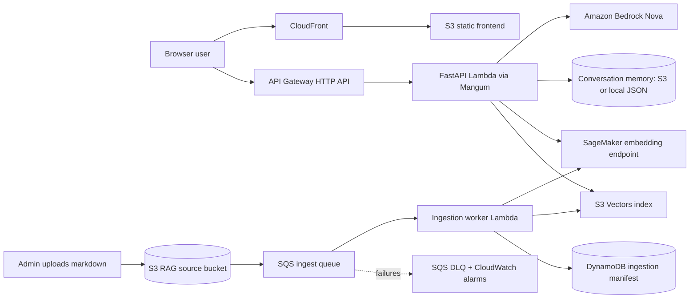
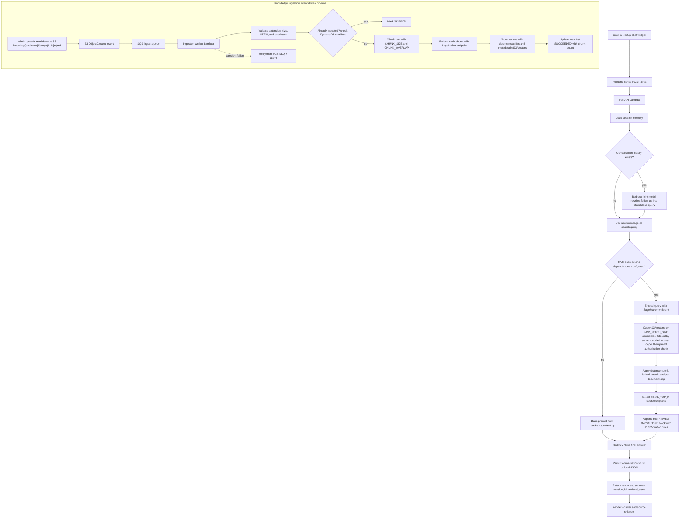

# Prop Assist Twin

Technical README for running and deploying the project.

`prop-assist-twin` is a full-stack real-estate assistant PoC built as a digital twin experience. The frontend is a static Next.js application, the backend is a FastAPI service adapted to AWS Lambda with Mangum, and the inference layer is Amazon Bedrock with Nova models. Conversation state can be stored locally during development or in S3 in AWS deployments. The backend also includes an optional SageMaker-based embedding path exposed via `/embed` and S3 Vectors-backed RAG retrieval for `/chat`. Document ingestion runs as a separate event-driven pipeline (S3 → SQS → ingestion Lambda → S3 Vectors) tracked in a DynamoDB manifest; a synchronous `/ingest` route remains available for local development only.

* * *

## Architecture



The frontend is statically exported by Next.js and served from S3 behind CloudFront. The browser calls the API Gateway URL directly. API Gateway invokes a Python Lambda package that hosts the FastAPI app through Mangum. Document ingestion is decoupled from the chat path: uploading a markdown file to the RAG source bucket emits an S3 event onto an SQS queue, which a dedicated ingestion worker Lambda consumes to chunk, embed, and index the document while recording status in a DynamoDB manifest.

### AWS components

  * S3 (frontend bucket) serves the statically exported Next.js app.
  * CloudFront sits in front of the S3 website endpoint.
  * API Gateway HTTP API exposes the backend endpoints.
  * Lambda runs the FastAPI application through Mangum.
  * Amazon Bedrock Runtime handles inference using the configured Nova model.
  * Amazon SageMaker can optionally host a serverless embedding endpoint used by `/embed`, RAG retrieval, and the ingestion worker.
  * S3 (memory bucket) stores conversation history in deployed environments.
  * S3 Vectors can optionally store indexed markdown chunks for RAG-backed `/chat` answers.
  * S3 (RAG source bucket) receives markdown uploads under `incoming/` in a strict key layout (audience, scope, document type, document id and business version; see [Document keys](#document-keys-and-front-matter)) and emits `ObjectCreated` events.
  * SQS queue + dead-letter queue buffer ingestion events and isolate failures.
  * A second Lambda (ingestion worker) consumes the queue, validates, chunks, embeds, and indexes documents.
  * DynamoDB stores the ingestion manifest for idempotency and status tracking.
  * CloudWatch alarms watch the DLQ, worker errors, and queue age.
  * Route 53 + ACM are optional and only used when a custom domain is enabled.

---

## RAG flow



`/chat` is a grounded generation pipeline with a small query-rewrite step in front of retrieval. The backend keeps recent chat state, rewrites follow-up questions into standalone search queries when needed, retrieves candidate chunks from S3 Vectors, reranks them with distance and lexical overlap signals, caps repeated chunks from the same document, and injects the selected snippets into the model prompt as a `RETRIEVED KNOWLEDGE` block.

Retrieval is tenant-aware. Each request carries an optional `tenant_id` (the server pins anonymous callers to one configured tenant, see the chat-scope note below; a key holder's omitted value means `admin`); each principal is resolved server-side to a **scope** from `backend/data/registry.json` (a tenant's leases and properties, or staff). The vector query carries the S3 Vectors metadata filter built from that scope (renters: renter-audience documents that are company-wide, in one of their properties or in one of their leases, and in force today; staff: everything in force) and every returned hit is re-checked in code, so a session only sees its own documents and renters never see `staff/` documents. The principal is fixed to a session on its first turn and persisted alongside the conversation, so later turns cannot switch it.

The final Bedrock Nova call is instructed by `backend/context.py` to answer in the user's language, use retrieved sources for company/listing/process/policy facts, and cite only the injected `[S#]` snippets. If RAG is disabled or the embedding/vector dependencies are missing, the app falls back to normal prompt-only Bedrock chat while still preserving session memory.

## Semantic text chunking

Both the ingestion worker and the local `/ingest` endpoint use **LangChain's `RecursiveCharacterTextSplitter`** for semantic text chunking. This respects document structure before falling back to character-based splitting, ensuring better RAG retrieval quality by maintaining semantic coherence within chunks.

### Splitting hierarchy

The `RecursiveCharacterTextSplitter` applies the following hierarchy to preserve document structure:

1. **Paragraph breaks** (`\n\n`) – Sections separated by blank lines are kept together
2. **Line breaks** (`\n`) – Single newlines form natural splitting points  
3. **Word boundaries** (space) – Words are preserved, never split mid-word
4. **Characters** – Fallback character splitting for oversized chunks

### Benefits

| Aspect | Improvement |
|--------|------------|
| **Paragraph coherence** | Chunks respect paragraph boundaries |
| **Line break awareness** | Single newlines preserve document structure |
| **Word integrity** | Words are never split mid-token |
| **Context continuity** | Configurable overlap maintains context between chunks |
| **Size guarantee** | All chunks respect maximum size limits |
| **RAG quality** | More coherent chunks → better vector embeddings |
| **Battle-tested** | Uses industry-standard LangChain implementation |

### Configuration

The chunker is controlled by existing environment variables:

| Variable | Default | Purpose |
|----------|---------|---------|
| `CHUNK_SIZE` | `1500` | Target chunk size in characters |
| `CHUNK_OVERLAP` | `200` | Character overlap between consecutive chunks for context continuity |

Note: `CHUNK_OVERLAP` must be less than `CHUNK_SIZE` (LangChain validation).

### Example

For a markdown document like:

```markdown
# Property Investment Guide

This is the introduction covering market trends and opportunities.

## Residential Properties

Single-family homes are standalone structures. They offer privacy and outdoor space.

### Market Analysis

The residential market shows strong growth potential. Prices have been rising steadily.
```

The `RecursiveCharacterTextSplitter` produces chunks that:
- Keep paragraphs together when possible (separated by `\n\n`)
- Respect line boundaries (separated by `\n`)
- Preserve word boundaries (separated by spaces)
- Maintain semantic coherence for better vector embeddings

This results in more relevant RAG retrieval compared to naive character-based splitting.

* * *

## Event-driven ingestion pipeline

In deployed environments, document ingestion is fully decoupled from the chat Lambda. The chat Lambda only **reads** from S3 Vectors (`QueryVectors`/`GetVectors`); a separate ingestion worker Lambda **writes** vectors. The two Lambdas share one deployment zip but use different handlers and IAM roles.

### Flow

1. An admin uploads a markdown file with front matter to the RAG source bucket under `incoming/`, following the [key layout](#document-keys-and-front-matter) (for example, `incoming/renters/leases/L-0001/contracts/lease-contract/v1.md`).
2. The S3 `ObjectCreated` event (filtered to the `incoming/` prefix and `.md` suffix) is delivered to an SQS queue.
3. The ingestion worker Lambda consumes the queue (batch size 1, partial-batch failure reporting enabled) and for each document:
   - reads the object from S3 and validates the key layout, size, UTF-8 content and front matter (one shared code path, `common/prepare.py`, also used by `/ingest` and the offline corpus validator),
   - computes a SHA-256 checksum and checks the DynamoDB manifest for idempotency,
   - chunks the content, embeds each chunk via the SageMaker endpoint, and writes vectors to S3 Vectors with deterministic IDs,
   - updates the manifest status and chunk count;
   - removes vectors of every other indexed version of the same key that is not S3's current version (manifest `SUPERSEDED`), so overwritten documents do not leave stale chunks searchable.

### Failure handling

| Scenario | Behavior |
| --- | --- |
| Key outside the layout (including every key of the former `incoming/{tenant}/...` layout), create or delete event | Acknowledged (no retry, no DLQ); nothing is read, indexed, deleted or recorded |
| Invalid file (bad front matter, non-UTF-8, empty, too large) | Manifest marked `FAILED` with every problem listed; message acknowledged (no retry) |
| Duplicate upload (same version/checksum already `SUCCEEDED`) | Manifest marked `SKIPPED`; no re-indexing (stale-version cleanup is re-attempted) |
| New business version (`v2.md` next to `v1.md`) | A different key: both stay indexed; retrieval picks the one in force on the date asked about |
| Overwrite (new S3 version of an indexed key) | New version indexed, then older versions' vectors deleted and marked `SUPERSEDED`. The current version is read via `HeadObject`, so out-of-order SQS delivery cannot let an old version win. Skipped if the bucket is unversioned or the object no longer exists |
| Embedding or vector-write failure | Message retried via SQS; after `max_receive_count`, routed to the DLQ |
| Throttling from the serverless embedding endpoint | Absorbed by adaptive botocore retries (`EMBEDDING_MAX_ATTEMPTS`) |

### Document keys and front matter

```text
incoming/{staff|renters}/company/{doc_type}/{doc_id}/v{n}.md
incoming/{staff|renters}/properties/{property_id}/{doc_type}/{doc_id}/v{n}.md
incoming/renters/leases/{lease_id}/{doc_type}/{doc_id}/v{n}.md
```

`doc_type` is one of `contracts`, `policies`, `sops`, `statements`; `doc_id` is a lowercase slug; `v{n}` is the **business version** (each version is its own key); `property_id` looks like `P-001` and `lease_id` like `L-0001` (opaque, no personal data). The path alone decides audience (`staff` documents are never shown to renters), scope and document identity. Each file starts with a front-matter block:

```text
---
title: Reparaturrichtlinie
language: de
effective_from: 2027-01-01
effective_to: 2027-12-31
---
```

`effective_to` is optional (omitted = open-ended); dates are strict `YYYY-MM-DD`. Design and rationale: [`docs/adr/0002-document-key-layout-and-access-scopes.md`](docs/adr/0002-document-key-layout-and-access-scopes.md). Validate a document tree offline with `cd backend && uv run python -m common.corpus` (see `backend/corpus/README.md`).

### Vector IDs and metadata

Vectors use deterministic IDs of the form `{audience}/{scope}[/{id}]/{doc_type}/{doc_id}/v{n}/{source_version_or_sha256}/{chunk_index}`, so retries safely overwrite the same chunks and equal file names in different scopes never collide. Each vector stores `audience`, `scope_type`, `property_id` (property scope only), `lease_id` (lease scope only), `doc_type`, `doc_id`, `doc_version`, `language`, `effective_from` and `effective_to` (integers `YYYYMMDD`; open-ended = `99991231`), `title`, `source_key`, `source_bucket`, `source_version`, `chunk_index`, `chunk_text`, `embedding_model`, and `ingested_at`. There is no `tenant_id`.

> **Retrieval** uses these fields: renters see company-wide documents, those of their properties and their own leases that are in force today; staff see everything in force. Vectors indexed under the former layout stay in the index untracked (the manifest table is replaced) and are invisible to everyone, since they lack `audience` and the dates; they are not removed automatically. Confirm that the real index honours the filter operators with `cd backend && uv run python -m common.filter_probe --bucket <vector-bucket> --index <index> --yes` (owner-approved: it writes probe vectors and deletes them again; see the module docstring), and re-run it after any change to the filter or the metadata fields. Use the bucket and index **names** (`terraform output -raw s3vectors_bucket_name` / `s3vectors_index_name`), not ARNs. A `NOTE` about list-valued probes is expected: S3 Vectors matches array-valued metadata when any element matches; the ingestion pipeline never writes lists and the per-hit check drops them. A `PROBLEM` line is a failure (`FILTER TOO LAX` means documents outside a scope were returned).

### DynamoDB manifest

The `rag_ingestion_manifest` table (on-demand billing) tracks every ingestion attempt. Partition key is `scope_key` (for example `renters/leases/L-0001`; it replaced `tenant_id`, and changing the key schema **replaces the table**); sort key is `{source_key}#{source_version_or_sha256}`. Allowed statuses are `PENDING`, `RUNNING`, `SUCCEEDED`, `FAILED`, `SKIPPED`, `DELETED`, and `SUPERSEDED`.

### Observability

Three CloudWatch alarms cover the pipeline: DLQ message count, worker Lambda errors, and queue age (oldest message). Set `alarm_sns_topic_arn` to receive notifications; otherwise alarms are visible in the console only.

### Local development

The synchronous `POST /ingest` endpoint still exists, but it is only registered when `LOCAL_DEV=true`. It takes a `source_key` in the layout above plus the file, runs the same preparation code as the worker (`common/prepare.py`) and writes the same metadata, and is not exposed through API Gateway in deployed environments.

* * *

## Repository layout

```text
.
├── .github/workflows/deploy.yml      # GitHub Actions deployment pipeline
├── backend/
│   ├── common/                        # Shared, client-agnostic logic (no FastAPI)
│   │   ├── chunking.py                # Markdown-aware text splitting
│   │   ├── embeddings.py              # SageMaker embedding invocation
│   │   ├── vector_store.py            # S3 Vectors put/query helpers
│   │   ├── config.py                  # Env-driven config for the worker
│   │   └── models.py                  # Shared pydantic models (SourceItem)
│   ├── ingestion/                     # Event-driven ingestion worker Lambda
│   │   ├── worker.py                  # SQS handler with partial-batch failures
│   │   ├── ingest_document.py         # Read, validate, chunk, embed, index one doc
│   │   └── manifest.py                # DynamoDB ingestion-status access
│   ├── data/registry.json            # Synthetic registry: tenants, leases, properties, staff (ships in the Lambda ZIP)
│   ├── corpus/                       # Synthetic German document corpus mirroring the RAG bucket (not shipped; see its README)
│   │   ├── areas.md
│   │   ├── buying_process.md
│   │   ├── company_faq.md
│   │   ├── property-listings.md
│   │   └── service_areas.md
│   ├── evals/golden_chat_cases.jsonl # Golden cases for AI smoke evaluation
│   ├── tests/                        # Pytest coverage for API, retrieval, and ingestion
│   ├── context.py                    # Persona, grounding, and query rewrite prompts
│   ├── deploy.py                     # Lambda package builder (shared by both Lambdas)
│   ├── eval_chat.py                  # Chat evaluation runner
│   ├── lambda_handler.py             # Mangum Lambda entrypoint (chat)
│   ├── server.py                     # FastAPI app, RAG, chat, memory
│   ├── pyproject.toml
│   ├── requirements.txt
│   └── uv.lock
├── frontend/
│   ├── app/
│   ├── components/twin.tsx           # Browser chat UI and source rendering
│   ├── next.config.ts                # Static export configuration
│   └── package.json
├── scripts/
│   ├── deploy.sh                     # Build, Terraform apply, frontend sync
│   └── destroy.sh                    # Empty buckets and Terraform destroy
├── terraform/                        # AWS infrastructure (ingestion.tf holds the pipeline)
└── README.md
```

* * *

## Tech stack


| Layer | Technology |
| --- | --- |
| Frontend | Next.js static export, React, TypeScript, Tailwind CSS |
| Backend | Python 3.12, FastAPI, Mangum, boto3, LangChain text splitters |
| Final LLM | Amazon Bedrock Nova, default `eu.amazon.nova-pro-v1:0` |
| Query rewrite model | Amazon Bedrock Nova Micro, default `eu.amazon.nova-micro-v1:0` |
| Text chunking | LangChain `RecursiveCharacterTextSplitter` for semantic document chunking |
| Embeddings | Optional SageMaker serverless Hugging Face endpoint |
| Vector store | Optional S3 Vectors bucket and index |
| Ingestion pipeline | S3 event → SQS (+ DLQ) → ingestion worker Lambda → S3 Vectors, with DynamoDB manifest |
| Session memory | Local JSON files or S3 object storage |
| Infrastructure | Terraform, API Gateway HTTP API, Lambda, S3, CloudFront |
| CI/CD | GitHub Actions, OIDC to AWS, Terraform, uv, npm |

* * *

## Prerequisites

- AWS CLI configured for the target account.
- Terraform installed locally for manual deployment.
- Python 3.12 and `uv` for backend development.
- Node.js 20+ and npm for frontend development.
- Bedrock model access in the target AWS region.
- Optional: SageMaker + S3 Vectors enabled if you want RAG and `/ingest`.

* * *

## Local backend development

From the repository root:

```bash
cd backend
uv sync
```

Useful local environment variables:

```bash
export DEFAULT_AWS_REGION=eu-central-1
export BEDROCK_MODEL_ID=eu.amazon.nova-pro-v1:0
export BEDROCK_LIGHT_MODEL_ID=eu.amazon.nova-micro-v1:0
export CORS_ORIGINS=http://localhost:3000

# Local conversation memory
export USE_S3=false
export MEMORY_DIR=../memory

# Local admin development convenience.
# When ADMIN_API_KEY is empty and LOCAL_DEV=true, admin endpoints are allowed.
export LOCAL_DEV=true
export ADMIN_API_KEY=

# Optional RAG and ingestion dependencies
export RAG_ENABLED=true
export SAGEMAKER_ENDPOINT=
export VECTOR_BUCKET=
export VECTOR_INDEX=

# Optional RAG tuning
export RAW_FETCH_SIZE=12
export FINAL_TOP_K=3
export MAX_CHUNKS_PER_DOC=2
export MAX_CONTEXT_CHARS=1500
export MAX_RETRIEVAL_DISTANCE=
export SOURCE_SNIPPET_CHARS=280

# Semantic chunking (markdown-aware with fallback to character-based)
export CHUNK_SIZE=1500
export CHUNK_OVERLAP=200

# Request limits
export MAX_MESSAGE_CHARS=3000
export MAX_UPLOAD_BYTES=1048576
export LOG_LEVEL=INFO
```

Run the API:

```bash
uvicorn server:app --reload --port 8000
```

Backend smoke checks:

```bash
curl http://localhost:8000/health

curl -X POST http://localhost:8000/chat \
  -H 'content-type: application/json' \
  -d '{"message":"Which property would you recommend for a family?"}'
```

> **Chat scope.** Locally (`LOCAL_DEV=true`, no `ADMIN_API_KEY`) `/chat` accepts any `tenant_id`. In a deployed environment anonymous callers are pinned to `PUBLIC_CHAT_TENANT_ID` (403 for any other tenant, 503 if unset); send `x-api-key` to choose a tenant such as `admin`.

Admin-only endpoints require `x-api-key` when `ADMIN_API_KEY` is set:

```bash
curl -X POST http://localhost:8000/embed \
  -H 'content-type: application/json' \
  -H "x-api-key: $ADMIN_API_KEY" \
  -d '{"text":"Hello world"}'

curl -X POST http://localhost:8000/ingest \
  -H "x-api-key: $ADMIN_API_KEY" \
  -F "source_key=incoming/renters/company/policies/repair-policy/v1.md" \
  -F "file=@repair-policy.md"   # a markdown file that starts with front matter
```

> The `/ingest` route is only available when `LOCAL_DEV=true`. In deployed
> environments, ingest documents by uploading them to the RAG source bucket
> (see [RAG knowledge ingestion](#rag-knowledge-ingestion)).

Run tests:

```bash
uv run pytest -q
```

Tests run with coverage enabled. The suite enforces a minimum coverage
threshold of 90% across `server.py`, `common/`, and `ingestion/` (configured via
`fail_under` in `backend/pyproject.toml`); `uv run pytest` fails if coverage
drops below it.

Run the golden chat evaluation against a deployed or local API:

```bash
API_URL=http://localhost:8000 uv run python eval_chat.py
```

The runner reads `API_URL` (not `API_BASE_URL`) and these optional variables:

| Variable | Default | Purpose |
| --- | --- | --- |
| `EVAL_CASES` | `evals/golden_chat_cases.jsonl` | Fixture to run |
| `EVAL_TIMEOUT_SECONDS` | `60` | Per-request timeout |
| `EVAL_RESULTS` | unset | Write a machine-readable run record (JSON) to this path; unset writes no file |
| `EVAL_API_KEY` | unset | Sent as `x-api-key` (privileged scope). Environment only; never written to the record or printed. Refused over plain HTTP to a non-local host |

Behaviour:

- The whole fixture is validated first. A line that is not valid JSON, has an unknown key (for example a typo such as `",min_sources"`), has a wrong type, or defines no check is a fixture error: exit **2**, no API call. The same validation runs offline in `tests/test_eval_fixtures.py`.
- Every case gets its own session (`eval-<run>-<n>`), so reruns and case order cannot influence each other.
- Each case ends as **PASS**, **FAIL** (an assertion or an unexpected 4xx) or **ERROR** (transport failure, 5xx, unreadable body). A dead or refusing API produces ERRORs with the detail, not a traceback. Exit **0** = all passed, **1** = any FAIL or ERROR, **2** = could not run or write results.
- The run record holds the run id, dataset path and SHA-256, the target's public `/health` flags (model, RAG, public-chat), per-case status/HTTP status/latency/effective tenant/sources/failures/answer excerpt, and a summary with p50/p95 latency over the answered requests (the sample size `n` is included; with a handful of cases p95 is just the maximum).
- A case may set `tenant_id` and `expect_status` to test refusals (then only `must_not_contain` applies, to the raw refusal text).

Labeled property-management cases (100 cases, 17 categories: lease and property facts, precedence, outdated versions, co-tenants, English, triage, escalation, staff questions, unanswerable, privacy, isolation, injection) run against the synthetic corpus in `backend/corpus/`. They need an **ingested** deployment, and to act as different tenants a privileged caller (`EVAL_API_KEY`, or a `LOCAL_DEV` server):

```bash
API_URL=http://localhost:8000 EVAL_API_KEY=... EVAL_CASES=evals/property_cases.jsonl EVAL_RESULTS=run.json uv run python eval_chat.py
```

Results are also reported per `category`. The cases name their `expected_docs` (evidence document references); the runner does not score retrieval against them yet because the API does not return source document IDs (ADR 0002 slice 6). Offline, `tests/test_eval_corpus_alignment.py` proves the labels agree with the corpus and the access rules; see `docs/use_case.md` for the acceptance criteria.

Access-boundary smoke check for a deployed, contained API. Run it **anonymously** (no `EVAL_API_KEY`). Both cases expect the same `403`: anonymous `admin` and an unregistered tenant are refused alike, and the refusal text must not reveal which tenants exist. It fails if either gets an answer or a different status, and reports ERROR (503) if anonymous chat is disabled because `PUBLIC_CHAT_TENANT_ID` is unset:

```bash
API_URL=https://<api> EVAL_CASES=evals/access_boundary_cases.jsonl uv run python eval_chat.py
```

Against a deployed API, anonymous requests are pinned to `PUBLIC_CHAT_TENANT_ID`. This runner measures one live answer per case; it does not yet compute retrieval Recall@k or grounding scores.

---

## Local frontend development

```bash
cd frontend
npm ci
NEXT_PUBLIC_API_URL=http://localhost:8000 npm run dev
```

Open the local Next.js app in a browser. The chat component sends `POST /chat` requests and renders returned sources below assistant messages.

Build the static export:

```bash
NEXT_PUBLIC_API_URL=http://localhost:8000 npm run build
```

* * *

## Environment variables

### Backend Lambda / FastAPI

| Variable | Required | Default | Purpose |
| --- | --- | --- | --- |
| `DEFAULT_AWS_REGION` | yes in AWS | boto3 default | AWS region for Bedrock, SageMaker, S3, and S3 Vectors clients |
| `BEDROCK_MODEL_ID` | no | `eu.amazon.nova-pro-v1:0` | Final answer model |
| `BEDROCK_LIGHT_MODEL_ID` | no | `eu.amazon.nova-micro-v1:0` | Lightweight query rewrite model |
| `CORS_ORIGINS` | no | `*` | Comma-separated allowed browser origins |
| `USE_S3` | no | `true` | Store conversation memory in S3 when true |
| `S3_BUCKET` | when `USE_S3=true` | empty | Bucket for conversation memory |
| `MEMORY_DIR` | when `USE_S3=false` | `../memory` | Local conversation memory directory |
| `SAGEMAKER_ENDPOINT` | for `/embed`, ingestion, RAG | empty | Embedding endpoint name |
| `VECTOR_BUCKET` | for ingestion, RAG | empty | S3 Vectors bucket name |
| `VECTOR_INDEX` | for ingestion, RAG | empty | S3 Vectors index name |
| `RAG_ENABLED` | no | `true` | Enables retrieval when embedding and vector dependencies exist |
| `RAW_FETCH_SIZE` | no | `12` | Raw vector candidates fetched before reranking |
| `FINAL_TOP_K` | no | `3` | Final source chunks passed to the answer model and returned to frontend |
| `MAX_CHUNKS_PER_DOC` | no | `2` | Per-document diversity cap during retrieval |
| `MAX_CONTEXT_CHARS` | no | `1500` | Maximum retrieved context injected into final prompt |
| `MAX_RETRIEVAL_DISTANCE` | no | empty | Optional vector distance cutoff; empty disables cutoff |
| `SOURCE_SNIPPET_CHARS` | no | `280` | Maximum snippet length returned per source |
| `CHUNK_SIZE` | no | `1500` | Target chunk size in characters for semantic chunking (markdown-aware with sentence fallback) |
| `CHUNK_OVERLAP` | no | `200` | Character overlap between consecutive chunks for context continuity |
| `EMBEDDING_MAX_ATTEMPTS` | no | `10` | Max adaptive botocore retries for SageMaker `InvokeEndpoint` (absorbs serverless throttling) |
| `ADMIN_API_KEY` | for deployed admin routes | empty | Shared admin key for `/embed` and `/conversation/{session_id}` (and local `/ingest`) |
| `LOCAL_DEV` | no | `false` | Allows admin endpoints without a key when no admin key is set, and registers the local `/ingest` route |
| `PUBLIC_CHAT_TENANT_ID` | for public chat | empty | The single synthetic-only **registered tenant** (see `backend/data/registry.json`) whose scope anonymous `/chat` callers receive. Empty or invalid (staff such as `admin`, or unregistered) disables anonymous chat (503). `x-api-key` with `ADMIN_API_KEY` lifts the pin. Terraform: `public_chat_tenant_id`. See `docs/adr/0003-p0-public-chat-containment.md` |
| `NEXT_PUBLIC_SHOW_TENANT_PICKER` | no | unset | Frontend build flag: `true` shows the tenant picker for local development only. It is not authorization |
| `MAX_MESSAGE_CHARS` | no | `3000` | Maximum incoming chat message length |
| `MAX_UPLOAD_BYTES` | no | `1048576` | Maximum markdown upload size for ingestion |
| `LOG_LEVEL` | no | `INFO` | Backend logging level |

### Ingestion worker Lambda

The ingestion worker shares the backend deployment package but is configured independently. In addition to the shared embedding/vector/chunking variables above, it uses:

| Variable | Required | Default | Purpose |
| --- | --- | --- | --- |
| `MANIFEST_TABLE` | yes | empty | DynamoDB ingestion manifest table name |
| `RAG_DOCS_BUCKET` | no | empty | S3 source bucket name (informational) |
| `EMBEDDING_MODEL` | no | `sentence-transformers/all-MiniLM-L6-v2` | Model name recorded in vector metadata |
| `INGESTION_MAX_WORKERS` | no | `4` | Per-document embedding fan-out (keep ≤ endpoint max concurrency) |
| `EMBEDDING_MAX_ATTEMPTS` | no | `10` | Adaptive retry budget for embedding throttling |

### Frontend

| Variable | Required | Purpose |
|---|---:|---|
| `NEXT_PUBLIC_API_URL` | yes | Base URL of the backend API |

* * *

## Manual AWS deployment

### 1. Bootstrap remote Terraform state

The deployment script expects an S3 bucket for Terraform state and a DynamoDB table for state locking.

```bash
export AWS_ACCOUNT_ID=$(aws sts get-caller-identity --query Account --output text)
export AWS_REGION=${DEFAULT_AWS_REGION:-eu-central-1}

aws s3api create-bucket \
  --bucket twin-terraform-state-${AWS_ACCOUNT_ID} \
  --region ${AWS_REGION} \
  --create-bucket-configuration LocationConstraint=${AWS_REGION}

aws dynamodb create-table \
  --table-name twin-terraform-locks \
  --attribute-definitions AttributeName=LockID,AttributeType=S \
  --key-schema AttributeName=LockID,KeyType=HASH \
  --billing-mode PAY_PER_REQUEST \
  --region ${AWS_REGION}
```

If the bucket or table already exists, skip that resource.

### 2. Configure Terraform variables

Edit `terraform/terraform.tfvars` for your environment. The checked-in development file currently enables SageMaker embeddings, S3 Vectors, and RAG.

Example:

```hcl
project_name = "prop-assist-twin"
environment  = "dev"

default_aws_region = "eu-central-1"
bedrock_model_id = "eu.amazon.nova-pro-v1:0"
bedrock_light_model_id = "eu.amazon.nova-micro-v1:0"

lambda_timeout = 60
api_throttle_burst_limit = 10
api_throttle_rate_limit = 5

use_custom_domain = false
root_domain = ""

sagemaker_embedding_enabled = true
sagemaker_embedding_model_name = "sentence-transformers/all-MiniLM-L6-v2"
sagemaker_embedding_image_uri = "763104351884.dkr.ecr.eu-central-1.amazonaws.com/huggingface-pytorch-inference:1.13.1-transformers4.26.0-cpu-py39-ubuntu20.04"
sagemaker_embedding_serverless_memory_mb = 3072
sagemaker_embedding_max_concurrency = 2

s3vectors_enabled = true
s3vectors_index_name = "property-kb"
s3vectors_dimension = 384
s3vectors_distance_metric = "cosine"
s3vectors_non_filterable_metadata_keys = ["chunk_text"]

rag_enabled = true
raw_fetch_size = 5
final_top_k = 3
max_chunks_per_doc = 2
max_context_chars = 1500
max_retrieval_distance = 0.35
source_snippet_chars = 200
chunk_size = 1500
chunk_overlap = 200
max_message_chars = 3000
max_upload_bytes = 1048576
log_level = "INFO"

# Event-driven ingestion pipeline
rag_ingest_enabled = true
rag_ingest_lambda_timeout = 300
rag_ingest_lambda_memory = 1024
rag_ingest_reserved_concurrency = 3
rag_ingest_max_receive_count = 5
rag_ingest_batch_size = 1
rag_ingest_queue_age_alarm_seconds = 900
alarm_sns_topic_arn = ""
ingestion_max_workers = 2
embedding_max_attempts = 10
```

Pass `admin_api_key` through `TF_VAR_admin_api_key` or a secure variable source rather than committing it to `terraform.tfvars`.

### 3. Deploy

```bash
chmod +x scripts/deploy.sh
export DEFAULT_AWS_REGION=eu-central-1
export TF_VAR_admin_api_key='change-me-to-a-real-secret'
./scripts/deploy.sh dev prop-assist-twin
```

The deployment script builds the Lambda package, initializes Terraform with the remote backend, applies infrastructure, writes `frontend/.env.production` with the deployed API URL, builds the static frontend, and syncs `frontend/out` to the frontend S3 bucket.

### 4. Destroy

```bash
chmod +x scripts/destroy.sh
export DEFAULT_AWS_REGION=eu-central-1
./scripts/destroy.sh dev prop-assist-twin
```

The destroy script empties managed frontend and memory buckets before running Terraform destroy.

---

## GitHub Actions deployment

The workflow at `.github/workflows/deploy.yml` runs on pushes to `main` and on manual dispatch. It uses GitHub OIDC to assume an AWS role, installs Python 3.12, `uv`, Terraform, Node 20, and frontend dependencies, then runs frontend lint/build, backend package build, Terraform format/validation, backend tests, and `scripts/deploy.sh`. The backend test step enforces the 90% coverage gate and fails the deployment if coverage drops below the threshold.

Required GitHub secrets:

| Secret | Purpose |
| --- | --- |
| `AWS_ROLE_ARN` | IAM role assumed by GitHub Actions through OIDC |
| `DEFAULT_AWS_REGION` | AWS region used by the workflow and deployment script |
| `ADMIN_API_KEY` | Admin key passed to Terraform as `TF_VAR_admin_api_key` |

---

## RAG knowledge ingestion

Documents must follow the [key layout and front matter](#document-keys-and-front-matter). The synthetic corpus lives in `backend/corpus/` (outside `data/`, so staff-only documents never ship in the Lambda ZIP) and mirrors the bucket, so a validated tree is uploaded as is. Uploading changes live AWS state and incurs SageMaker/SQS/Lambda cost: only with the owner's explicit approval.

```bash
cd backend
uv run python -m common.corpus --require-documents      # same checks the worker applies

RAG_DOCS_BUCKET=$(terraform -chdir=../terraform output -raw rag_docs_bucket)
aws s3 sync corpus/incoming "s3://${RAG_DOCS_BUCKET}/incoming" --exclude ".*" --exclude "*/.*"
```

The former seed files in `backend/data/kb/` were removed: they predate the layout (no front matter, no scope) and could not be ingested. The worker acknowledges and ignores any key outside the layout. The worker validates the key, size, UTF-8 content and front matter, deduplicates by version/checksum, and records status in the manifest. For quick local testing you can instead use the synchronous `POST /ingest` route with `LOCAL_DEV=true`.

### K2 corpus (admin tenant PoC dataset) — superseded

> **No longer applicable.** This workflow uploads to `incoming/Tenants/admin/`, a layout the worker now rejects, and the K2 documents have no front matter. It is kept only as a record; adapting it would need a converter that writes the new layout and front matter. Keep K2 out of any public demo (it is real-world data and the old `admin` partition was unfiltered).

For a larger RAG PoC dataset, the `admin` tenant can be seeded from the [K2 corpus](https://zenodo.org/records/7425489), a public collection of 2,110 German-language documents (contracts, policies, reports) released as two packages:

- `XML/` — one XML file per document (`d{id}.xml`), already OCR'd and split into `<page>` → `<heading>`/`<sentence>` elements. Each element carries a `frequent` attribute (`yes`/`no`) flagging whether that exact text repeats often (templated headings, running boilerplate) versus is unique to that spot in the document.
- `K2_PDFs/` — the matching source PDFs (one per XML document, linked via the XML's `fname` attribute). Not used here — the XML already has clean extracted text, so no PDF parsing is needed.

This dataset is not part of the repository. Download and unpack both Zenodo packages under the gitignored `temp/` directory as `temp/XML/` and `temp/K2_PDFs/`, then use `temp/build_corpus_markdown.py` (stdlib + boto3 only) to convert and upload:

```bash
# Convert only, no upload: writes temp/md_output/*.md for review.
# Headings/sentences with frequent='yes' are dropped as boilerplate (falling
# back to the unfiltered text if that would leave a document empty).
python3 temp/build_corpus_markdown.py --dry-run

# Upload the next batch of 10 not-yet-uploaded documents to
# incoming/Tenants/admin/, tracking progress in temp/upload_state.json so
# re-running the same command continues with the next batch. Requires boto3
# (e.g. run with backend/.venv/bin/python3) and an AWS session that can write
# to the RAG source bucket.
python3 temp/build_corpus_markdown.py --bucket "$RAG_DOCS_BUCKET"

# Once satisfied with a few batches, upload everything remaining in one run.
python3 temp/build_corpus_markdown.py --bucket "$RAG_DOCS_BUCKET" --all
```

Batching by default (rather than uploading all 2,110 at once) keeps the burst of S3 events, and the resulting ingestion worker/SageMaker invocations, within the serverless embedding endpoint's small configured concurrency (`sagemaker_embedding_max_concurrency`).

* * *

## API endpoints

### `GET /health`

Returns service status and configuration flags for memory, embeddings, vectors, and RAG.

### `POST /chat`

Request:

```json
{
  "message": "Which properties are available in Berlin?",
  "session_id": "optional-existing-session",
  "tenant_id": "T001"
}
```

`tenant_id` is optional and the **server decides the effective scope**. Only its
shape is validated (`422` for a malformed value). The registered principals are in
`backend/data/registry.json`: tenants `T001`-`T004` and staff `admin`. Anonymous
callers are pinned to `PUBLIC_CHAT_TENANT_ID` (which must be a registered tenant):
an omitted `tenant_id` resolves to it, **any** other tenant, registered or not (or
reusing a session bound to another tenant), returns the same `403`, and `503`
means anonymous chat is disabled. Only a caller with a valid `x-api-key` may choose
a principal (an omitted value means `admin`; an unregistered one is `422`).
Renters retrieve from company-wide documents, their properties' and their own
leases'; `admin` is staff and sees everything in force. The principal is bound to
the session on its first turn: once a session exists, its stored principal is
authoritative. See `docs/adr/0003-p0-public-chat-containment.md` and
`docs/adr/0002-document-key-layout-and-access-scopes.md`.

Response shape:

```json
{
  "response": "...",
  "session_id": "...",
  "tenant_id": "T001",
  "sources": [
    {
      "id": "company_faq-0",
      "title": "company_faq.md",
      "source_path": "company_faq.md",
      "snippet": "...",
      "doc_type": "markdown",
      "chunk_index": 0,
      "distance": 0.18
    }
  ],
  "retrieval_used": true
}
```

### `POST /embed` admin

Embeds text using the configured SageMaker endpoint. Requires `x-api-key` when `ADMIN_API_KEY` is configured.

### `POST /ingest` admin (local only)

Accepts a markdown upload plus a required `source_key` form field in the [key layout](#document-keys-and-front-matter) (for example `incoming/renters/leases/L-0001/contracts/lease-contract/v1.md`; the upload's own file name is ignored). It runs the same preparation as the worker (key grammar, size, UTF-8, front matter, `RecursiveCharacterTextSplitter` chunking), embeds each chunk, and writes vectors with the worker's metadata under `{key}/local/{chunk}` IDs, so re-uploading a key overwrites its own chunks. Errors: `422` key outside the layout, `413` over `MAX_UPLOAD_BYTES`, `400` invalid content (the detail lists every problem). The operator chooses the scope, exactly like the S3 key for the worker; this is not a pattern for user-facing paths. The route is only registered when `LOCAL_DEV=true`; deployed ingestion runs through the [event-driven pipeline](#event-driven-ingestion-pipeline). See [Semantic text chunking](#semantic-text-chunking) for chunking strategy details.

### `GET /conversation/{session_id}` admin

Reads stored conversation history for a session. This route exists in the FastAPI app and is protected by the same admin key, but it is not exposed as an API Gateway route in the current Terraform configuration.

* * *

## Notes and troubleshooting

- Bedrock model access must be enabled in the same region used by the Lambda.
- The default final model is `eu.amazon.nova-pro-v1:0`; the default rewrite model is `eu.amazon.nova-micro-v1:0`.
- RAG only runs when `RAG_ENABLED=true` and `SAGEMAKER_ENDPOINT`, `VECTOR_BUCKET`, and `VECTOR_INDEX` are all configured.
- `POST /chat` still works without RAG; it simply skips retrieval and answers from the base prompt plus conversation history.
- `POST /embed` and the local `POST /ingest` route will fail if no SageMaker embedding endpoint is configured.
- The event-driven ingestion pipeline and RAG retrieval require S3 Vectors configuration; the pipeline additionally requires `rag_ingest_enabled = true` (along with `s3vectors_enabled` and `sagemaker_embedding_enabled`).
- Keep `ingestion_max_workers` at or below `sagemaker_embedding_max_concurrency` to avoid self-inflicted `InvokeEndpoint` throttling; transient throttling is otherwise absorbed by `EMBEDDING_MAX_ATTEMPTS` adaptive retries.
- Ingestion failures land in the SQS DLQ. Inspect the DynamoDB manifest for the `FAILED` reason, fix the document, and either re-upload it or redrive the DLQ.
- In local development, set `LOCAL_DEV=true` with an empty `ADMIN_API_KEY` to avoid blocking yourself on admin-only routes (this also enables the local `/ingest` route).
- In deployed environments, always set a non-empty `ADMIN_API_KEY` and send it as `x-api-key` for admin routes.